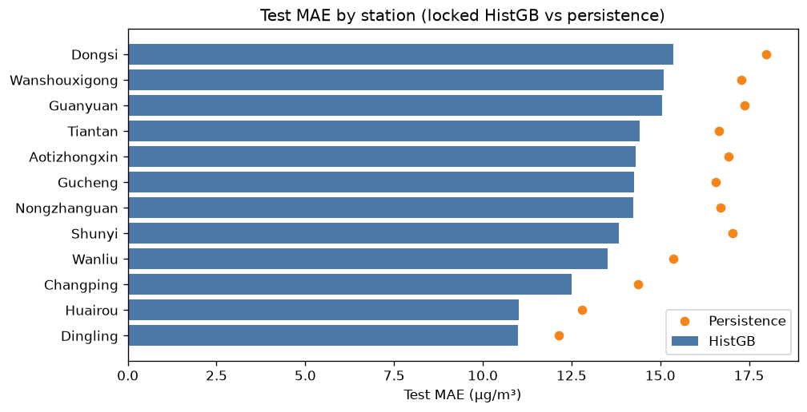
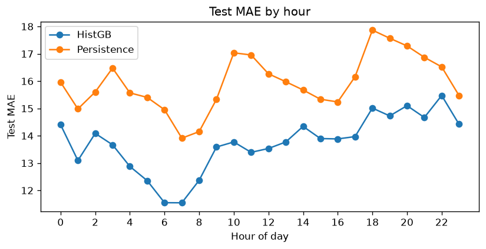
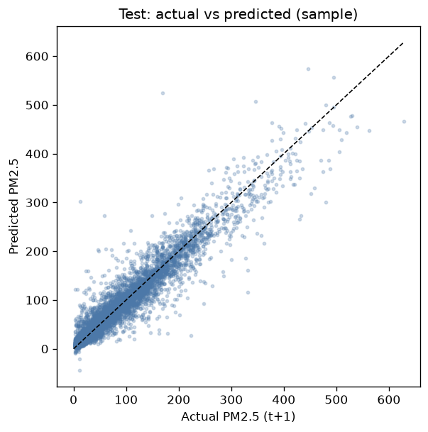
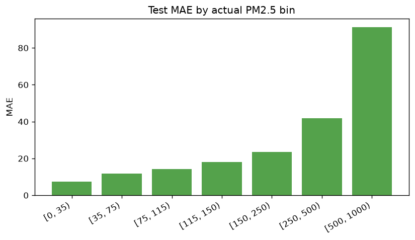

# Phase 10e – Forecast error analysis

**Locked model:** HistGradientBoosting (global, PM2.5 t+1h)  
**Primary test:** 2016-07-01 → 2016-12-31  
**Test n:** 48,935

## Overall (test)

| Model | MAE | RMSE | R² |
|-------|-----|------|----|
| Persistence | 15.934 | 28.763 | 0.8720 |
| **HistGB (locked)** | **13.722** | **23.677** | **0.9133** |

MAE lift vs persistence: **2.212** µg/m³ (13.9% relative).

## By station (test)

- Best MAE: **Dingling** (10.99) — cluster `cleaner_outskirts`
- Worst MAE: **Dongsi** (15.36) — cluster `elevated_core`

Full table: `error_by_station_test.csv`.

## By cluster (test)

| cluster | label | n | MAE | Persistence MAE | Lift |
|---------|-------|---|-----|-----------------|------|
| 0 | `elevated_core` | 36754 | 14.45 | 16.86 | 2.41 |
| 1 | `cleaner_outskirts` | 12181 | 11.51 | 13.13 | 1.61 |

## By season (test)

| season | n | MAE | Persistence MAE |
|--------|---|-----|-----------------|
| summer | 16492 | 10.36 | 11.68 |
| autumn | 23943 | 12.76 | 15.18 |
| winter | 8500 | 22.95 | 26.32 |

## Where errors hurt most

- Absolute error grows with **high actual PM2.5** (episode / pollution peaks) — see `error_residual_by_actual_bin_test.csv`.
- Persistence remains strong hour-to-hour; HistGB gain is largest where weather / lags / station structure add signal beyond lag-1.

### Worst station-days (test, by mean abs error)

| day | station | MAE | max\|err\| | mean actual |
|-----|---------|-----|-----------|-------------|
| 2016-12-20 | Wanliu | 105.9 | 295.4 | 355.6 |
| 2016-12-20 | Wanshouxigong | 103.5 | 551.9 | 409.0 |
| 2016-12-20 | Gucheng | 88.3 | 419.2 | 476.3 |
| 2016-12-20 | Guanyuan | 68.3 | 216.5 | 408.2 |
| 2016-12-16 | Dongsi | 63.9 | 200.2 | 139.8 |
| 2016-12-30 | Dongsi | 63.2 | 208.3 | 282.9 |
| 2016-12-04 | Guanyuan | 61.8 | 164.5 | 301.0 |
| 2016-12-21 | Gucheng | 61.8 | 130.1 | 460.4 |

## 2017 sensitivity (optional, not DoD)

2017 Jan–Feb only (winter-biased); not primary DoD

- n = 15,866
- HistGB MAE = **19.522**
- Persistence MAE = **20.732**
- Beats persistence: **True**

Interpret cautiously: Jan–Feb 2017 is winter-only and short.

## Artifacts

- `error_by_*.csv`, `error_worst_days_test.csv`
- `error_analysis.md` (this file)
- figures under `artifacts/forecasting/figures/`
- mart: `mart.mart_pm25_predictions`

