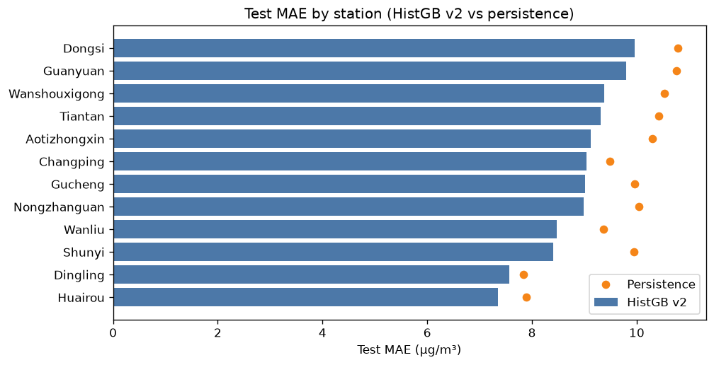
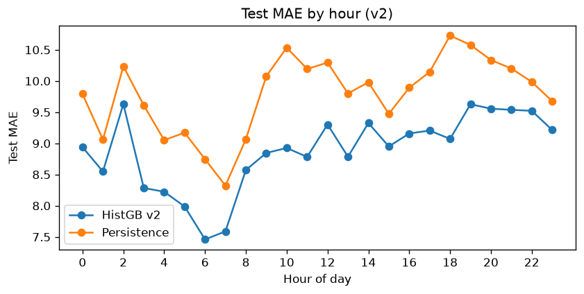
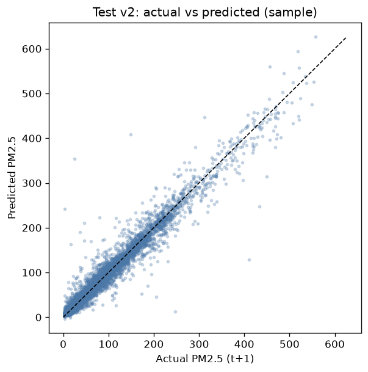
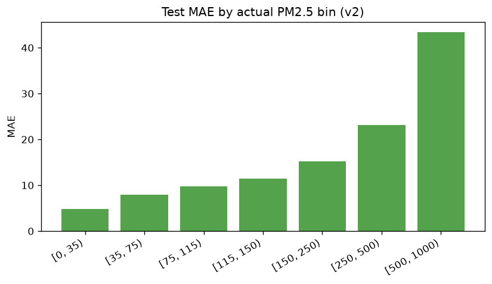

# Vòng A – Forecast error analysis v2

**Model:** HistGradientBoosting v2 (features + sample weight)  
**Primary test:** 2016-07-01 → 2016-12-31  
**Test n:** 48,781

## So sánh tổng (test)

| Model | Test MAE |
|-------|----------|
| Persistence | 9.783 |
| HistGB v1 (production lock) | 9.144 |
| **HistGB v2** | **8.872** |

Lift v2 vs persistence: **0.911** µg/m³.  
Δ vs v1 (v2 − v1): **-0.27174731777701666** (âm = v2 tốt hơn).

## Khuyến nghị

HistGB v2 thắng cả persistence và lock v1 trên test. **Đã Promote** (2026-10-12): `model_lock.json` / `models/pm25_forecast/` / `mart.mart_pm25_predictions` dùng v2; backup v1 tại `promote_backup_v1/`.

## By station (test)

- Best MAE: **Huairou** (7.35)
- Worst MAE: **Dongsi** (9.96)

## By cluster (test)

| cluster | label | n | MAE | Persistence MAE | Lift |
|---------|-------|---|-----|-----------------|------|
| 0 | `elevated_core` | 36653 | 9.16 | 10.23 | 1.07 |
| 1 | `cleaner_outskirts` | 12128 | 8.00 | 8.42 | 0.42 |

## By season (test)

| season | n | MAE | Persistence MAE |
|--------|---|-----|-----------------|
| summer | 16411 | 6.87 | 7.42 |
| autumn | 23892 | 8.40 | 9.33 |
| winter | 8478 | 14.08 | 15.61 |

## By actual bin (test)

| bin | n | MAE |
|-----|---|-----|
| [0, 35) | 17781 | 4.83 |
| [35, 75) | 11428 | 7.94 |
| [75, 115) | 7926 | 9.74 |
| [115, 150) | 4273 | 11.45 |
| [150, 250) | 5306 | 15.19 |
| [250, 500) | 1990 | 23.16 |
| [500, 1000) | 77 | 43.44 |

### Worst station-days (test)

| day | station | MAE | max\|err\| | mean actual |
|-----|---------|-----|-----------|-------------|
| 2016-12-20 | Wanliu | 69.9 | 244.9 | 355.6 |
| 2016-12-20 | Gucheng | 55.4 | 359.2 | 476.3 |
| 2016-07-26 | Wanshouxigong | 54.4 | 234.5 | 53.6 |
| 2016-12-20 | Wanshouxigong | 49.7 | 465.8 | 409.0 |
| 2016-12-16 | Dongsi | 45.9 | 166.9 | 139.8 |
| 2016-12-20 | Changping | 44.8 | 187.3 | 383.8 |
| 2016-12-20 | Guanyuan | 43.7 | 185.6 | 408.2 |
| 2016-12-30 | Shunyi | 42.9 | 231.4 | 161.0 |

## Artifacts

- `error_v2_*.csv`, `error_analysis_v2.md`
- `model_comparison_v2.json`, `model_lock_v2.json`
- Production lock **unchanged:** `model_lock.json`

