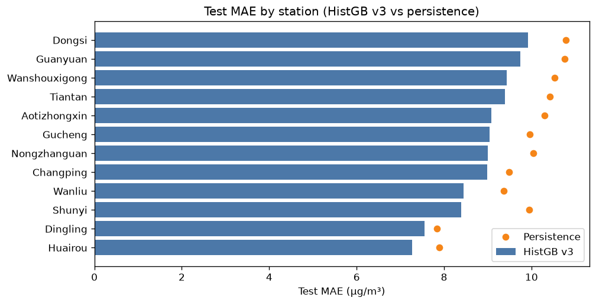
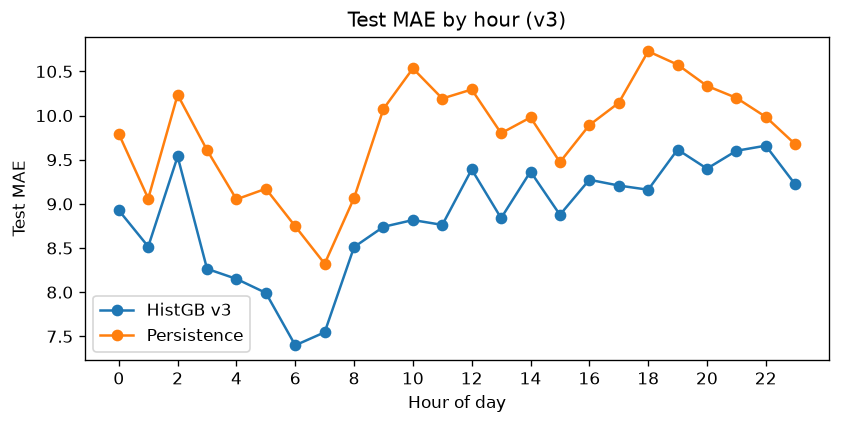
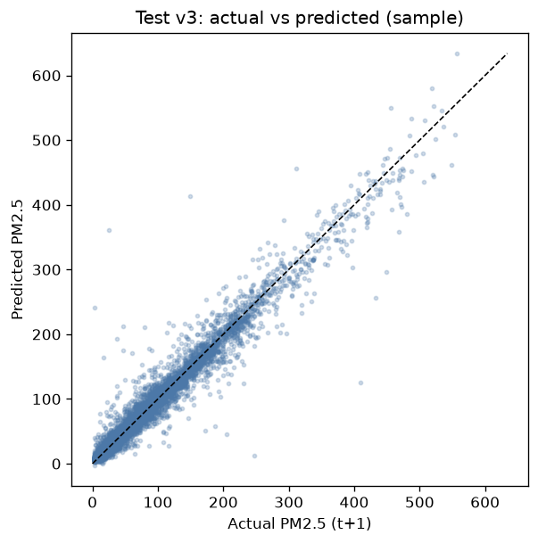
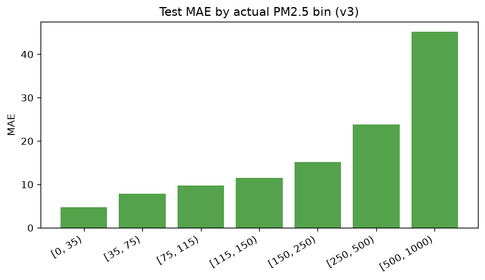

# Feature v3 – Forecast error analysis

**Model:** HistGradientBoosting v3 (O3/SO2 + cloud_cover + sample weight)  
**Primary test:** 2016-07-01 → 2016-12-31  
**Test n:** 48,781

## So sánh tổng (test)

| Model | Test MAE |
|-------|----------|
| Persistence | 9.783 |
| HistGB v2 (production lock) | 8.872 |
| **HistGB v3** | **8.860** |

Lift v3 vs persistence: **0.923** µg/m³.  
Δ vs v2 (v3 − v2): **-0.012043790394628218** (âm = v3 tốt hơn).

## Khuyến nghị

HistGB v3 thắng cả persistence và lock v2 trên test — đủ điều kiện **cân nhắc Promote** (plan riêng: mart + dashboard). Trước Promote nên kiểm tra thêm MAE bin ≥115/≥150 và mùa đông.

## By station (test)

- Best MAE: **Huairou** (7.27)
- Worst MAE: **Dongsi** (9.92)

## By cluster (test)

| cluster | label | n | MAE | Persistence MAE | Lift |
|---------|-------|---|-----|-----------------|------|
| 0 | `elevated_core` | 36653 | 9.16 | 10.23 | 1.07 |
| 1 | `cleaner_outskirts` | 12128 | 7.95 | 8.42 | 0.47 |

## By season (test)

| season | n | MAE | Persistence MAE |
|--------|---|-----|-----------------|
| summer | 16411 | 6.85 | 7.42 |
| autumn | 23892 | 8.37 | 9.33 |
| winter | 8478 | 14.13 | 15.61 |

## By actual bin (test)

| bin | n | MAE |
|-----|---|-----|
| [0, 35) | 17781 | 4.76 |
| [35, 75) | 11428 | 7.89 |
| [75, 115) | 7926 | 9.72 |
| [115, 150) | 4273 | 11.48 |
| [150, 250) | 5306 | 15.14 |
| [250, 500) | 1990 | 23.86 |
| [500, 1000) | 77 | 45.24 |

### Worst station-days (test)

| day | station | MAE | max\|err\| | mean actual |
|-----|---------|-----|-----------|-------------|
| 2016-12-20 | Wanliu | 70.4 | 248.1 | 355.6 |
| 2016-12-20 | Gucheng | 57.0 | 358.1 | 476.3 |
| 2016-07-26 | Wanshouxigong | 53.2 | 234.3 | 53.6 |
| 2016-12-20 | Wanshouxigong | 52.6 | 453.0 | 409.0 |
| 2016-12-20 | Changping | 46.7 | 190.3 | 383.8 |
| 2016-12-16 | Dongsi | 44.7 | 169.0 | 139.8 |
| 2016-12-20 | Guanyuan | 44.2 | 176.1 | 408.2 |
| 2016-12-30 | Shunyi | 41.5 | 235.5 | 161.0 |

## Artifacts

- `error_v3_*.csv`, `error_analysis_v3.md`
- `model_comparison_v3.json`, `model_lock_v3.json`
- Production lock **unchanged:** `model_lock.json`

