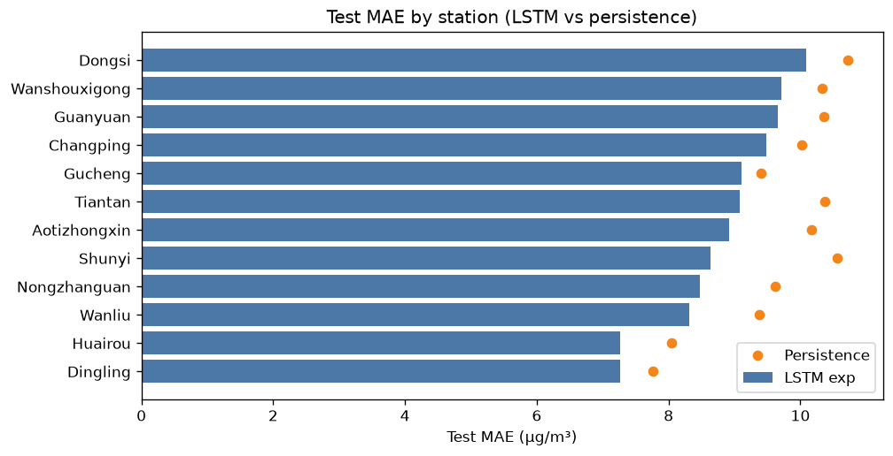
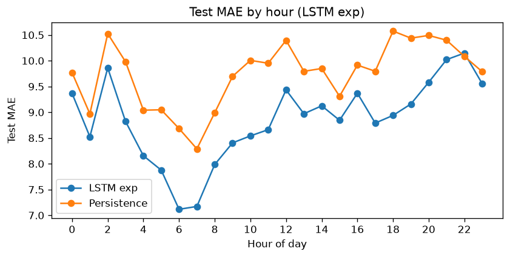
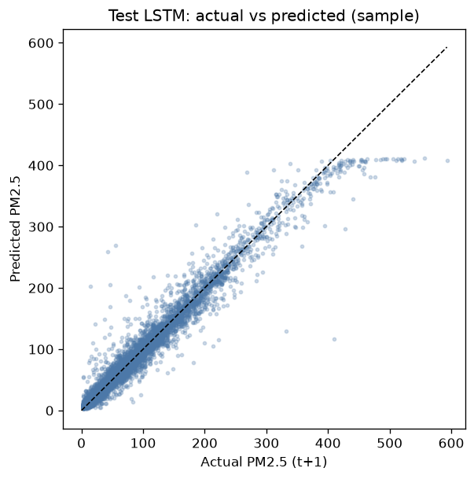
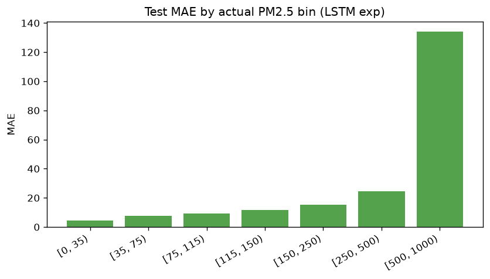

# Vòng B – Forecast error analysis LSTM experiment

**Model:** PyTorch LSTM (seq=24, hidden=64)  
**Primary test:** 2016-07-01 → 2016-12-31  
**Test n (sequences):** 40,511

## So sánh tổng (test)

| Model | Test MAE |
|-------|----------|
| Persistence | 9.741 |
| HistGB v2 (production) | 8.872 |
| **LSTM exp** | **8.851** |

Lift LSTM vs persistence: **0.889** µg/m³.  
Δ vs HistGB v2 (LSTM − v2): **-0.020464217672424567** (âm = LSTM tốt hơn).

## Khuyến nghị

LSTM thắng persistence và HistGB v2 trên test — **cân nhắc Promote** (plan riêng; chưa làm trong vòng này). Winter MAE LSTM≈14.75 vs HistGB v2≈14.08. High-bin (≥150) MAE LSTM≈15.26 vs v2≈16.60.

## By station (test)

- Best MAE: **Dingling** (7.26)
- Worst MAE: **Dongsi** (10.09)

## By cluster (test)

| cluster | label | n | MAE | Persistence MAE | Lift |
|---------|-------|---|-----|-----------------|------|
| 0 | `elevated_core` | 30803 | 9.11 | 10.09 | 0.98 |
| 1 | `cleaner_outskirts` | 9708 | 8.02 | 8.63 | 0.61 |

## By season (test)

| season | n | MAE | Persistence MAE |
|--------|---|-----|-----------------|
| summer | 13207 | 6.56 | 7.32 |
| autumn | 20008 | 8.22 | 9.32 |
| winter | 7296 | 14.75 | 15.29 |

## By actual bin (test)

| bin | n | MAE |
|-----|---|-----|
| [0, 35) | 14790 | 4.53 |
| [35, 75) | 9689 | 7.71 |
| [75, 115) | 6600 | 9.34 |
| [115, 150) | 3482 | 11.73 |
| [150, 250) | 4202 | 15.24 |
| [250, 500) | 1682 | 24.71 |
| [500, 1000) | 66 | 134.25 |

### Worst station-days (test)

| day | station | MAE | max\|err\| | mean actual |
|-----|---------|-----|-----------|-------------|
| 2016-12-20 | Gucheng | 123.0 | 342.3 | 476.3 |
| 2016-12-20 | Wanshouxigong | 76.3 | 404.9 | 409.0 |
| 2016-12-20 | Wanliu | 65.3 | 248.1 | 355.6 |
| 2016-12-20 | Guanyuan | 56.7 | 186.6 | 408.2 |
| 2016-12-21 | Gucheng | 55.4 | 110.2 | 460.4 |
| 2016-12-04 | Dongsi | 55.0 | 147.2 | 309.8 |
| 2016-12-31 | Dongsi | 54.7 | 102.3 | 462.1 |
| 2016-12-20 | Changping | 52.7 | 161.7 | 383.8 |

## Artifacts

- `error_lstm_exp_*.csv`, `lstm_exp_error_analysis.md`
- `lstm_exp_comparison.json`, `lstm_exp_lock.json`
- Production lock **unchanged:** `model_lock.json`

