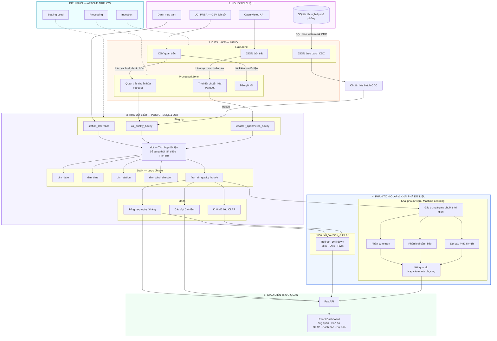

# ARCHITECTURE.md

> **Project:** Phân tích và dự báo ô nhiễm không khí theo khu vực và điều kiện thời tiết  
> **Vai trò tài liệu:** Mô tả kiến trúc kỹ thuật và luồng dữ liệu của dự án  
> **Phiên bản:** 1.2
> **Cập nhật:** 23/10/2026
>
> Tài liệu này cần được đọc cùng:
>
> - `PROJECT_CONTEXT.md`
> - `DATA_GUIDE.md`
>
> `PROJECT_CONTEXT.md` mô tả **dự án làm gì**.  
> `DATA_GUIDE.md` mô tả **dữ liệu phải được xử lý thế nào**.  
> `ARCHITECTURE.md` mô tả **các thành phần kỹ thuật phối hợp với nhau ra sao**.

---

# 1. Mục tiêu kiến trúc

Kiến trúc cần đáp ứng các yêu cầu:

- tích hợp nhiều nguồn dữ liệu;
- lưu giữ dữ liệu thô;
- pipeline có thể chạy lại;
- tách ingestion, processing và warehouse modeling;
- đảm bảo data lineage;
- hỗ trợ phân tích lịch sử;
- hỗ trợ Data Mining và Machine Learning;
- cung cấp dữ liệu cho Web Dashboard;
- đủ rõ để hai thành viên cùng phát triển;
- chạy được trên máy Windows bằng Docker;
- ưu tiên công nghệ open-source;
- không sử dụng công nghệ phân tán nếu chưa cần thiết.

---

# 2. Kiến trúc tổng thể

Sơ đồ luồng dữ liệu phân tầng. Mũi tên liền biểu diễn dữ liệu;
mũi tên nét đứt biểu diễn điều phối.



CSV và SQLite là hai kênh lấy dữ liệu từ cùng bộ UCI. Nhánh CDC được chuẩn hóa
rồi upsert staging trực tiếp; nhánh CSV và API đi qua Parquet. Open-Meteo bổ sung
thời tiết thiếu khi tích hợp bằng dbt.

Sơ đồ thể hiện luồng dữ liệu tổng thể. Chi tiết replay CDC, dự báo và đánh giá
liên tục từ staging nằm trong [thiết kế CDC](OPERATIONAL_DB_INGESTION_DESIGN.md).
Các phần dưới lưu các nguyên tắc và lựa chọn thiết kế ban đầu.

---

# 3. Kiến trúc logic theo layer

Dự án được chia thành các layer:

```text
Source
↓
Ingestion
↓
Data Lake
↓
Processing
↓
Staging
↓
Transformation
↓
Data Warehouse
↓
Analytics / ML
↓
Presentation
```

Mỗi layer phải có trách nhiệm riêng.

Không để một component làm quá nhiều nhiệm vụ.

---

# 4. Source Layer

Nguồn dữ liệu chính:

## 4.1. UCI PRSA

Dạng:

```text
CSV files
```

Vai trò:

- nguồn dữ liệu chất lượng không khí chính;
- cung cấp dữ liệu lịch sử theo giờ;
- chứa cả pollutant và weather measurement đi kèm.

Dự kiến:

```text
12 station CSV files
```

Mỗi file tương ứng một monitoring station.

---

## 4.2. Open-Meteo

Dạng:

```text
REST API
↓
JSON
```

Vai trò:

- nguồn dữ liệu khí tượng bổ sung (REST/JSON);
- minh họa pipeline ingest API và join đa nguồn;
- **fill weather UCI missing** (UCI vẫn là primary — không thay thế khi UCI đã có giá trị);
- enrichment biến UCI không có (ưu tiên `cloud_cover`);
- tuỳ chọn đối chiếu khi hai nguồn cùng có giá trị.

Chi tiết biến và source priority: `DATA_GUIDE.md` §24 / `PROJECT_CONTEXT.md` §15.

Không mặc định Open-Meteo thay thế weather có sẵn trong UCI.

---

## 4.3. Station Reference

Dạng dự kiến:

```text
CSV / seed
```

Bao gồm:

```text
station_code
station_name
latitude
longitude
district
metadata_source
```

Chỉ bổ sung trường địa lý khi đã xác minh.

---

# 5. Ingestion Layer

Công cụ:

```text
Apache Airflow
+
Python
```

Airflow điều phối việc lấy dữ liệu từ Source Layer.

Ví dụ:

```text
Airflow DAG
│
├── ingest_uci_files
├── ingest_station_reference
└── ingest_openmeteo_weather
```

---

# 6. Vai trò Airflow

Airflow chịu trách nhiệm:

- scheduling;
- orchestration;
- dependency;
- retries;
- logging;
- monitoring;
- trigger downstream tasks.

Airflow không nên chứa toàn bộ logic xử lý dữ liệu trực tiếp trong DAG file.

Ví dụ không nên:

```text
airflow_dag.py
    ↓
500 dòng Pandas cleaning
```

Nên:

```text
Airflow task
    ↓
gọi module Python
    ↓
src/processing/...
```

Điều này giúp:

- dễ test;
- dễ tái sử dụng;
- DAG dễ đọc;
- giảm phụ thuộc vào Airflow.

---

# 7. Data Lake Layer

Công nghệ:

```text
MinIO
```

MinIO là nơi lưu source data trước khi transform thành warehouse data.

Mục tiêu chính:

- bảo toàn raw source;
- tách source khỏi downstream processing;
- giúp pipeline chạy lại;
- lưu nhiều format;
- hỗ trợ lineage;
- tránh phụ thuộc hoàn toàn vào nguồn bên ngoài.

---

# 8. MinIO bucket strategy

Không cần quá nhiều bucket.

Đề xuất ban đầu:

```text
air-quality-lake
```

Bên trong dùng prefix:

```text
raw/
processed/
reference/
```

Ví dụ:

```text
air-quality-lake/

├── raw/
│   ├── uci/
│   │   └── air_quality/
│   └── openmeteo/
│       └── historical_weather/
│
├── reference/
│   └── stations/
│
└── processed/
    ├── air_quality/
    └── weather/
```

Nếu sau khi triển khai thấy tách bucket tốt hơn, có thể điều chỉnh.

---

# 9. Raw Zone

Raw Zone phải gần source nhất có thể.

Ví dụ:

```text
raw/uci/air_quality/
    PRSA_Data_Aotizhongxin_...
    PRSA_Data_Changping_...
    ...
```

Open-Meteo:

```text
raw/openmeteo/historical_weather/
    station=aotizhongxin/
    station=changping/
```

Không thực hiện:

- rename columns;
- interpolation;
- aggregation;
- drop missing;
- feature engineering;

trong Raw Zone.

---

# 10. Raw immutability

Raw data được coi là immutable.

Nếu source được ingest lại:

không overwrite âm thầm bản trước.

Có thể dùng:

```text
ingestion_date=
```

hoặc version/checksum để phân biệt.

Mục tiêu:

> Có thể tái tạo downstream data từ một snapshot raw cụ thể.

---

# 11. Processed Zone

Processed data là dữ liệu đã:

- parse;
- validate;
- canonicalize;
- chuẩn hóa datatype;
- chuẩn hóa timestamp;
- chuẩn hóa unit;
- bổ sung metadata lineage.

Format ưu tiên:

```text
Parquet
```

Ví dụ:

```text
processed/air_quality/
    station=wanshouxigong/
        year=2013/
        ...
```

Partition strategy cuối cùng chưa chốt.

Không partition quá nhỏ gây nhiều file vụn.

---

# 12. Processing Layer

Công nghệ chính:

```text
Python
+
Pandas
```

Processing Layer phụ trách những thao tác phù hợp với file/API data.

Ví dụ:

- parse CSV;
- parse JSON;
- combine timestamp;
- cast datatype;
- validate range;
- missing profiling;
- normalize station name;
- unit conversion;
- convert to Parquet.

---

# 13. Data validation

Data validation xảy ra ở nhiều điểm.

## Source validation

Kiểm tra:

- file tồn tại;
- API request thành công;
- response không rỗng;
- required column tồn tại.

## Schema validation

Kiểm tra:

- datatype;
- required fields;
- timestamp;
- station.

## Business/data quality validation

Kiểm tra:

- pollutant âm;
- wind speed âm;
- duplicate station-hour;
- missing timestamps;
- missing values;
- extreme values.

Không nên dồn tất cả validation về cuối pipeline.

---

# 14. Quarantine concept

Các record nghiêm trọng có thể được đưa vào một khu vực riêng thay vì:

```text
delete
```

Ví dụ:

```text
processed/quarantine/
```

Candidate cases:

- timestamp invalid;
- station unknown;
- negative pollutant;
- schema violation.

Không cần triển khai quarantine phức tạp nếu dataset không phát sinh nhiều lỗi, nhưng architecture phải cho phép.

---

# 15. Staging Layer

Công nghệ:

```text
PostgreSQL
```

Staging nhận dữ liệu đã đủ sạch để relational transformation.

Ví dụ schema:

```text
staging
```

Candidate tables:

```text
staging.air_quality_hourly
staging.weather_openmeteo_hourly
staging.station_reference
```

---

# 16. Vai trò Staging

Staging:

- gần với processed data;
- giữ grain gốc;
- cung cấp input cho dbt;
- dễ debug;
- dễ kiểm tra source-to-target.

Không dùng staging trực tiếp làm dashboard nếu không cần.

Không coi staging là Data Warehouse cuối.

---

# 17. Load strategy

Dataset lịch sử hiện khá nhỏ.

Ưu tiên simplicity.

Initial load:

```text
Full historical load
```

Sau đó API data có thể hỗ trợ incremental.

Bổ sung CDC kiểu watermark cho nguồn SQLite mô phỏng; xem
`OPERATIONAL_DB_INGESTION_DESIGN.md`. Nhánh CSV lịch sử vẫn chạy batch.

Không cần streaming.

Không cần Kafka.

---

# 18. Idempotency

Pipeline phải cố gắng idempotent.

Ví dụ chạy lại cùng batch:

```text
không tạo duplicate
```

Natural key:

```text
station + event_time
```

có thể được dùng để kiểm tra duplication.

Load implementation có thể dùng:

```text
upsert
```

hoặc:

```text
truncate/reload
```

tùy layer.

Cách cuối sẽ được quyết định theo từng bảng.

---

# 19. dbt Layer

dbt chạy trên PostgreSQL.

Flow:

```text
staging
↓
dbt staging models
↓
intermediate models
↓
dimensional models
↓
marts
```

Không bắt buộc tạo đủ tất cả layer nếu dataset đơn giản.

---

# 20. dbt model hierarchy

Định hướng:

```text
models/

├── staging/
├── intermediate/
├── marts/
└── warehouse/
```

Hoặc cấu trúc đơn giản hơn nếu hợp lý.

---

# 21. dbt staging models

dbt staging model thực hiện những transformation SQL nhẹ:

- rename;
- cast;
- normalize;
- source abstraction;
- basic tests.

Ví dụ:

```text
stg_air_quality
stg_weather_openmeteo
stg_station
```

---

# 22. Intermediate models

Dùng khi logic đủ phức tạp để tách riêng.

Ví dụ:

```text
int_air_quality_weather_joined
```

hoặc:

```text
int_station_hourly_features
```

Không tạo intermediate model chỉ để tăng số folder.

---

# 23. Data Warehouse Layer

Warehouse nằm trong PostgreSQL.

Candidate schema:

```text
dwh
```

Dimensional modeling được ưu tiên.

---

# 24. Grain chính

Working grain:

> Một trạm tại một giờ.

```text
station_id
+
event_hour
```

Đây là grain thuận lợi cho:

- pollutant analysis;
- weather analysis;
- time-series;
- dashboard;
- downstream ML.

---

# 25. Candidate dimensions

## DimDate

Có thể chứa:

```text
date_key
date
year
quarter
month
month_name
day
day_of_week
week
season
```

## DimTime

Có thể chứa:

```text
time_key
hour
hour_label
day_part
```

Có thể gộp Date + Time tùy thiết kế sau này.

## DimStation

```text
station_key
station_code
station_name
latitude
longitude
district
```

Chỉ dùng geo metadata đã xác minh.

---

# 26. Candidate Fact

Candidate:

```text
FactAirQualityHourly
```

Grain:

```text
station-hour
```

Measures:

```text
pm25
pm10
so2
no2
co
o3

temperature
pressure
dew_point
rain
wind_speed
...
```

Weather có nằm cùng fact hay tách riêng chưa chốt.

---

# 27. Weather modeling options

Có hai phương án chính.

## Option A – cùng một fact

```text
FactAirQualityHourly
```

chứa:

- pollutants;
- weather.

Ưu điểm:

- cùng grain;
- đơn giản;
- dashboard dễ query.

## Option B – hai fact

```text
FactAirQualityHourly
FactWeatherHourly
```

Ưu điểm:

- tách source/domain;
- linh hoạt nếu weather có nhiều nguồn.

Nhược:

- query phức tạp hơn;
- dễ over-design.

Quyết định sau profiling Open-Meteo.

---

# 28. Mart Layer

Dashboard không nhất thiết query fact hàng triệu lần trực tiếp.

Có thể xây:

```text
mart_station_daily
mart_station_monthly
mart_pollution_weather
mart_pm25_episodes
mart_pm25_multi_station_events
```

`mart_pm25_episodes` / `mart_pm25_multi_station_events` phục vụ phân tích đợt PM2.5 cao (theo trạm, đa-trạm, weather tóm tắt).  
**Đã chốt Phase 8:** ngưỡng **115** µg/m³, min **3** giờ, đa-trạm **K=6** — xem `artifacts/eda/episode_definition.md`. Mart sẵn cho dashboard Phase 11.

Mục tiêu:

- query nhanh;
- logic thống nhất;
- dashboard đơn giản hơn.

Không tạo mart nếu query trực tiếp đã đủ tốt và logic không lặp.

Dashboard (FastAPI) nên đọc từ:

```text
PostgreSQL DWH / marts
```

Không nên mặc định đọc:

```text
raw CSV
```

vì như vậy bỏ qua toàn bộ kiến trúc warehouse.

---

# 30. Machine Learning Data Access

ML không đọc trực tiếp Raw.

Flow:

```text
DWH
↓
ML feature query
↓
feature dataset
↓
train / validation / test
```

ML dataset có thể được export:

```text
Parquet
```

hoặc đọc trực tiếp PostgreSQL.

---

# 31. ML feature pipeline

Candidate flow:

```text
Warehouse hourly data
        ↓
Sort by station + time
        ↓
Create lag features
        ↓
Create rolling features
        ↓
Create target t+1
        ↓
Chronological split
        ↓
Train
        ↓
Evaluate
```

Feature creation cần tách rõ khỏi data cleaning.

---

# 32. Model artifact

Model sau training nên được lưu thành artifact.

Candidate:

```text
models/
    pm25_forecast/
        model.joblib
        metadata.json
```

Metadata có thể gồm:

```text
model_name
training_period
features
target
metrics
created_at
dataset_version
```

Không chỉ lưu mỗi file `.pkl` rồi mất ngữ cảnh.

---

# 33. Prediction output

Prediction có thể được:

```text
ghi vào PostgreSQL
```

hoặc:

```text
tạo realtime khi user yêu cầu
```

Phiên bản đầu ưu tiên đơn giản.

Table (Phase 10d):

```text
mart.mart_pm25_predictions
```

Cột chính:

```text
station_key / station_name
prediction_origin_time
target_time
split
actual_pm25
predicted_pm25
predicted_pm25_persistence
model_version
absolute_error
cluster_id
```

Nguồn: `staging.pm25_predictions_raw` (COPY từ locked predictions). Dùng cho dashboard so sánh predicted vs actual.

---

# 34. Dashboard architecture

```text
React (Vite) + Mantine
    ↓  HTTP JSON
FastAPI
    ↓  SQL (read-only)
PostgreSQL
    ↓
DWH (dim_*) / marts (mart_*)
```

Prediction page:

```text
React
    ↓
FastAPI
    ↓
mart.mart_pm25_predictions
```

Map page: join `dwh.dim_station` (lat/lon) + PM/cluster từ marts. Heatmap nội suy = ngoài DoD P11.

Không auth; không đọc raw CSV cho kết quả chính.

---

# 35. Dashboard caching

Có thể dùng cache ngắn hạn ở FastAPI (response / query) sau khi endpoint đúng.

Không cache credential. Caching chỉ tối ưu sau khi dashboard chạy đúng.

---

# 36. Container architecture

Docker Compose dự kiến chứa:

```text
postgres
minio
airflow-webserver
airflow-scheduler
airflow-triggerer nếu cần
airflow-db nếu tách riêng
```

Có thể dùng PostgreSQL riêng cho Airflow metadata hoặc chia instance với database khác.

Khuyến nghị:

> tách logical database/schema rõ ràng để Airflow metadata không lẫn với project warehouse.

---

# 37. Suggested logical databases

Ví dụ:

```text
airflow_db
air_quality_dw
```

Trong:

```text
air_quality_dw
```

có:

```text
staging
dwh
mart
```

---

# 38. Network

Các container nên nằm cùng Docker network.

Ví dụ:

```text
air-quality-network
```

Service communication dùng Docker service name:

```text
postgres:5432
minio:9000
```

Không hard-code:

```text
localhost
```

từ container này sang container khác.

---

# 39. Port convention

Candidate development ports:

```text
Airflow UI     : 8080
MinIO API      : 9000
MinIO Console  : 9001
PostgreSQL     : 5432
Dashboard API  : 8100 (host; container internal 8000)
Dashboard Web  : 5173+ (dev, next free) / 3000 (prod)
```

Nếu port conflict trên máy Windows, có thể map host port khác mà không đổi container port.

---

# 40. Configuration

Sử dụng `.env`.

Ví dụ:

```text
POSTGRES_HOST=
POSTGRES_PORT=
POSTGRES_DB=
POSTGRES_USER=
POSTGRES_PASSWORD=

MINIO_ENDPOINT=
MINIO_ACCESS_KEY=
MINIO_SECRET_KEY=

AIRFLOW_UID=
```

Không commit credential thật vào Git.

Tạo:

```text
.env.example
```

cho thành viên còn lại.

---

# 41. Secrets

Project hiện không có API key bắt buộc cho Open-Meteo basic usage.

Nếu sau này có secret:

- không hard-code;
- không commit Git;
- dùng environment variable;
- hoặc Airflow Connection/Variable phù hợp.

---

# 42. Repository structure

Candidate repository:

```text
air-quality-project/

├── airflow/
│   ├── dags/
│   └── plugins/
│
├── src/
│   ├── ingestion/
│   ├── processing/
│   ├── validation/
│   └── utils/
│
├── dbt/
│   └── air_quality_dbt/
│
├── dashboard/
│
├── ml/
│   ├── notebooks/
│   ├── features/
│   ├── training/
│   └── models/
│
├── tests/
│
├── docs/
│   ├── PROJECT_CONTEXT.md
│   ├── DATA_GUIDE.md
│   ├── ARCHITECTURE.md
│   ├── IMPLEMENTATION_PLAN.md
│   └── PROGRESS.md
│
├── docker-compose.yml
├── .env.example
├── .gitignore
└── README.md
```

Cấu trúc này là định hướng, không cần tạo mọi folder ngay ngày đầu.

---

# 43. Code responsibility

## `src/ingestion`

- download/import UCI;
- Open-Meteo API;
- MinIO upload/download.

## `src/processing`

- cleaning;
- normalization;
- Parquet conversion.

## `src/validation`

- schema checks;
- quality checks;
- profiling.

## `ml`

- EDA;
- feature engineering;
- model training;
- evaluation.

## `dashboard`

- `api/` — FastAPI (read-only SQL → JSON).
- `web/` — Vite + React + TypeScript + Mantine + ECharts + Leaflet.

---

# 44. Observability

Ở mức bài tập lớn cần tối thiểu:

- Airflow task status;
- Python logging;
- ingestion row count;
- rejected row count;
- load row count;
- dbt test result.

Không cần Prometheus/Grafana ở phase đầu.

---

# 45. Logging

Không chỉ log:

```text
success
```

Nên log thông tin có ích:

```text
source file
station
row count
start time
end time
missing count
output path
execution duration
```

Không log password hoặc credential.

---

# 46. Testing layers

## Python

Có thể dùng:

```text
pytest
```

cho:

- timestamp parser;
- station normalization;
- unit conversion;
- validation rules.

## dbt

Dùng:

```text
not_null
unique
relationships
accepted_values
```

khi phù hợp.

## Pipeline

Kiểm tra end-to-end bằng sample data trước khi chạy full data.

---

# 47. Development strategy

Không dựng toàn bộ architecture cùng lúc.

Ưu tiên vertical slice:

```text
1 station
↓
Raw MinIO
↓
Processed
↓
PostgreSQL staging
↓
dbt
↓
DWH
↓
Dashboard query
```

Khi một trạm chạy end-to-end ổn:

```text
expand → 12 stations
```

Cách này giúp tìm lỗi kiến trúc sớm.

---

# 48. Open-Meteo development strategy

Không bắt đầu bằng việc gọi 12 trạm × 4 năm ngay.

Trước tiên:

```text
1 station
+
1 month
```

để kiểm tra:

- timezone;
- coordinate;
- schema;
- units;
- API response;
- matching UCI.

Sau đó mới mở rộng.

Working preference biến (chi tiết trong `DATA_GUIDE.md` §24 / `PROJECT_CONTEXT.md` §15):

```text
RH            → derive từ TEMP + DEWP (sau resolve)
Open-Meteo    → cloud_cover (+ tối đa 1 biến phụ)
biến trùng    → UCI primary; Open-Meteo fill khi UCI missing
pollutant NA  → không fill bằng Open-Meteo
```

---

# 49. Data Warehouse development strategy

Không thiết kế 10 dimension ngay.

Bắt đầu từ grain:

```text
station-hour
```

sau đó build:

```text
DimStation
DimDate / DimTime
FactAirQualityHourly
```

Chỉ thêm structure khi có query/business requirement.

---

# 50. ML development strategy

Không bắt đầu ML trước warehouse.

Thứ tự:

```text
Data understood
↓
Warehouse stable
↓
EDA
↓
Baseline
↓
Feature engineering
↓
Model
↓
Evaluation
```

Có thể thử notebook sớm để hiểu dữ liệu, nhưng model cuối phải dựa trên pipeline dữ liệu đã kiểm soát.

---

# 51. Deployment scope

Environment chính:

```text
Windows development machine
+
Docker Desktop
```

Không yêu cầu:

- cloud;
- Kubernetes;
- CI/CD production;
- high availability.

Git được dùng để đồng bộ source code giữa hai thành viên.

---

# 52. Performance expectation

Dataset khoảng vài trăm nghìn row.

Do đó:

```text
Pandas + PostgreSQL
```

là đủ.

Không cần Spark ở quy mô hiện tại.

Nếu một bước chậm, tối ưu:

1. query;
2. indexes;
3. Parquet;
4. vectorized Pandas;
5. incremental processing;

trước khi nghĩ tới distributed computing.

---

# 53. Data lineage flow

Một analytical row phải có thể được truy ngược:

```text
Dashboard / Model
       ↓
DWH
       ↓
dbt model
       ↓
PostgreSQL staging
       ↓
Processed object
       ↓
Raw object
       ↓
Original source
```

Không cần xây lineage platform riêng.

Tên object/table và metadata phải đủ để truy vết thủ công.

---

# 54. Failure handling

## API failure

Airflow:

```text
retry
```

với giới hạn hợp lý.

Không tạo dữ liệu giả nếu API fail.

## Invalid source

Task:

```text
fail / quarantine
```

không silently continue nếu schema quan trọng sai.

## DWH test failure

Không coi pipeline thành công nếu dbt data-quality test quan trọng fail.

---

# 55. Reprocessing

Một mục tiêu quan trọng:

> Có thể xóa processed/staging và tạo lại từ Raw.

Không để transformation phụ thuộc vào thao tác thủ công không được ghi lại.

---

# 56. Incremental processing

Initial historical dataset:

```text
full load
```

sẽ đơn giản hơn.

Incremental strategy chỉ áp dụng khi:

- gọi thêm API;
- thêm dữ liệu mới;
- hoặc pipeline được mở rộng.

Không tối ưu incremental quá sớm.

---

# 57. Architecture boundaries

### Airflow

Điều phối.

### MinIO

Object/Data Lake storage.

### Python

File/API processing.

### PostgreSQL staging

Relational landing.

### dbt

SQL transformations/modeling.

### PostgreSQL DWH

Analytical warehouse.

### Scikit-learn

Mining/ML.

### Dashboard (FastAPI / React)

Presentation (read-only analytics UI).

Nếu một component bắt đầu làm vai trò của 3 component khác, cần xem lại thiết kế.

---

# 58. Những quyết định chưa khóa

Các điểm sau chưa phải final architecture:

- one fact hay two facts cho air quality/weather;
- Date + Time dimension tách hay gộp;
- processed partitioning;
- Open-Meteo role/variables cuối *(working preference: cloud + fill weather missing; RH derive)*;
- model artifact storage;
- prediction output strategy;
- dashboard map;
- Airflow DAG structure chi tiết.

Các quyết định này phải dựa vào triển khai thực tế.

---

# 59. Architecture change process

Nếu muốn thay đổi lớn:

```text
Current design
↓
Problem
↓
Alternative
↓
Benefit
↓
Cost
↓
Decision
```

Ví dụ hợp lệ:

> PostgreSQL handling tốt dataset hiện tại nên không cần Spark.

Hoặc:

> Weather source không tạo giá trị nên giảm scope Open-Meteo.

Không đổi công nghệ chỉ vì một tutorial sử dụng stack khác.

---

# 60. Definition of Architecture Done

Kiến trúc được xem là triển khai thành công khi có thể demo:

```text
UCI CSV / API
      ↓
Airflow
      ↓
MinIO Raw
      ↓
Processing
      ↓
MinIO Processed
      ↓
PostgreSQL Staging
      ↓
dbt
      ↓
DWH
      ↓
Dashboard
```

và riêng ML:

```text
DWH
↓
Feature dataset
↓
Train
↓
Evaluate
↓
Prediction result
↓
Dashboard
```

Mỗi bước phải giải thích được:

- input là gì;
- output là gì;
- component nào xử lý;
- vì sao component đó được sử dụng.

---

# 61. Nguyên tắc cuối

Kiến trúc phải:

> **đủ chuẩn để thể hiện kiến thức Data Engineering/Data Warehouse, nhưng không phức tạp hơn bài toán cần thiết.**

Ưu tiên:

```text
Simple
+
Correct
+
Reproducible
+
Explainable
+
Complete
```

hơn:

```text
Enterprise-looking
+
Incomplete
```

Một pipeline nhỏ chạy end-to-end tốt có giá trị hơn một sơ đồ kiến trúc rất lớn nhưng nhiều thành phần chỉ tồn tại trên slide.
