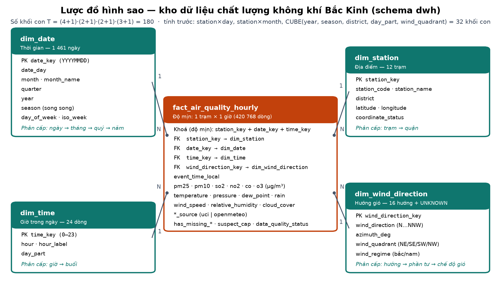
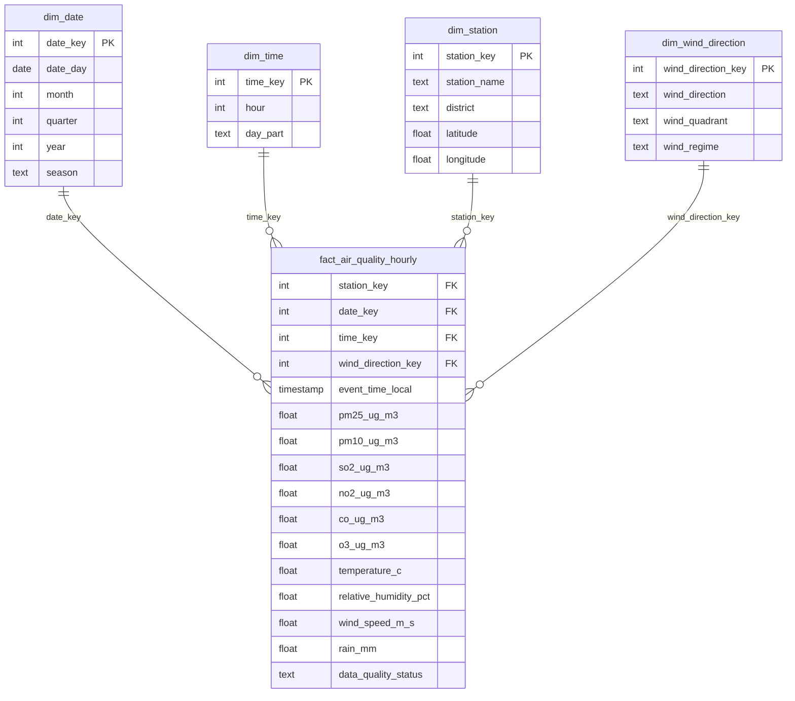

# DW_DESIGN.md — Thiết kế kho dữ liệu và OLAP

> Phần 2–4 của bài tập lớn INT1422: thiết kế lược đồ hình sao, cài đặt + tính trước khối con, dịch vụ OLAP.
> Mọi con số trong tài liệu này đều sinh từ hệ thống thật (`python scripts/run_all.py`).

---

## 1. Câu hỏi nghiệp vụ mà kho phải trả lời

**Người dùng:** trung tâm quan trắc môi trường / cơ quan y tế công cộng của thành phố.

**Quyết định cần hỗ trợ:** *khi nào và ở đâu* phát cảnh báo "hạn chế hoạt động ngoài trời" (PM2.5 ≥ 115 µg/m³, ngưỡng ô nhiễm trung bình theo chuẩn AQI Trung Quốc HJ 633-2012).

Kho dữ liệu phải trả lời nhanh các câu hỏi phân tích:

| Câu hỏi | Chiều cần dùng |
|---|---|
| Ô nhiễm biến động thế nào theo năm / quý / tháng / mùa? | Thời gian |
| Giờ nào, buổi nào trong ngày ô nhiễm nặng nhất? | Giờ trong ngày |
| Quận / trạm nào ô nhiễm nhất? | Địa điểm |
| Hướng gió nào đi kèm các đợt ô nhiễm? | Hướng gió |

Câu hỏi dự báo ("giờ tới có vượt ngưỡng không?") thuộc phần khai phá — xem `artifacts/classification/classification_report.md`.

---

## 2. Lược đồ hình sao

(Vẽ lại: `python scripts/draw_star_schema.py`.)

| Bảng | Số dòng | Mô hình dbt |
|---|---:|---|
| `dwh.fact_air_quality_hourly` | 420 768 | `models/warehouse/fact_air_quality_hourly.sql` |
| `dwh.dim_date` | 1 461 | `models/warehouse/dim_date.sql` |
| `dwh.dim_time` | 24 | `models/warehouse/dim_time.sql` |
| `dwh.dim_station` | 12 | `models/warehouse/dim_station.sql` |
| `dwh.dim_wind_direction` | 17 (16 hướng + UNKNOWN) | `models/warehouse/dim_wind_direction.sql` |

---

## 3. Độ mịn (grain) và lý do chọn

**Độ mịn: một dòng = một trạm × một giờ.**

Vì sao không chọn mức khác:

1. **Đó là độ mịn gốc của nguồn.** UCI PRSA ghi đúng một bản ghi mỗi giờ mỗi trạm. Gộp trước (ví dụ theo ngày) sẽ làm mất thông tin không lấy lại được: một ngày trung bình 80 µg/m³ có thể chứa 6 giờ liền trên 300 µg/m³.
2. **Mức chi tiết nhất thì cuộn lên được mọi mức.** Từ giờ có thể cuộn lên buổi, ngày, tháng, quý, năm, quận… Nhưng từ ngày thì không khoan xuống giờ được. Các nhu cầu theo ngày/tháng đã được phục vụ bằng khối con tính trước (mục 6), không cần hy sinh độ mịn của fact.
3. **Bài toán khai phá cần mức giờ.** Cảnh báo cho *giờ tới* (t+1h) và định nghĩa đợt ô nhiễm "≥ 115 µg/m³ liên tục ≥ 3 giờ" đều không tồn tại ở mức ngày.
4. **Kích thước vẫn nhỏ:** 420 768 dòng, PostgreSQL quét toàn bảng trong ~0,2 giây.

Tính duy nhất của độ mịn được kiểm tra bằng `tests/fact_grain_unique.sql` và `tests/fact_row_count.sql` (đúng 420 768 = 12 × 35 064).

---

## 4. Các chiều và phân cấp khái niệm

| Chiều | Phân cấp (từ mịn → thô) | Số mức Lᵢ | Ghi chú |
|---|---|---:|---|
| Thời gian (`dim_date`) | ngày → tháng → quý → năm | 4 | `season` là phân cấp song song (ngày → mùa) |
| Giờ trong ngày (`dim_time`) | giờ → buổi (`day_part`) | 2 | đêm 0–5h, sáng 6–11h, chiều 12–17h, tối 18–23h |
| Địa điểm (`dim_station`) | trạm → quận | 2 | 12 trạm, 8 quận |
| Hướng gió (`dim_wind_direction`) | hướng (16) → phần tư (4) → chế độ gió (2) | 3 | xem dưới |

**Vì sao thêm chiều Hướng gió?** Ba chiều đầu chỉ trả lời "khi nào / ở đâu". Hướng gió trả lời "vì sao": ở Bắc Kinh, gió nam mang không khí ẩm và bụi từ đồng bằng Hà Bắc, còn gió bắc đẩy ô nhiễm đi. Phép dice trên kho cho thấy điều này: mùa đông ở Dongcheng, PM2.5 trung bình **133 µg/m³ khi gió nam** so với **84 µg/m³ khi gió bắc** (`sql/olap/olap_operations.sql`, `dice_*`).

Phân cấp hướng gió:
- **Phần tư:** chia 90° bắt đầu từ hướng Bắc — Đông Bắc [0°, 90°), Đông Nam [90°, 180°), Tây Nam [180°, 270°), Tây Bắc [270°, 360°). Mỗi phần tư có đúng 4 hướng.
- **Chế độ gió:** gió bắc = Đông Bắc + Tây Bắc, gió nam = Đông Nam + Tây Nam.
- Thành viên `UNKNOWN` (khoá 0) bảo đảm fact không bao giờ có khoá ngoại NULL (kỹ thuật của Kimball). Sau khi lấp hướng gió từ Open-Meteo, hiện có 0 dòng rơi vào UNKNOWN.

---

## 5. Độ đo

| Độ đo | Loại | Cách tổng hợp đúng |
|---|---|---|
| `pm25_ug_m3`, các chất ô nhiễm khác | không cộng được theo thời gian | dùng `avg`. Khi cuộn lên từ khối con, phải lấy `sum / count`, **không** lấy trung bình của trung bình |
| số giờ quan trắc (`count(*)`) | cộng dồn (distributive) | `sum` |
| số giờ vượt ngưỡng (`pm25 >= 115`) | cộng dồn | `sum` |
| `rain_mm` | cộng dồn | `sum` |

Vì trung bình là độ đo đại số (algebraic), mọi khối con tính trước đều lưu cả `pm25_sum` (hoặc trung bình kèm `pm25_hour_count`) để cuộn lên tiếp mà không sai.

---

## 6. Khối con: số lượng và các khối được tính trước

**Số khối con** của khối 4 chiều có phân cấp (Bài 5): T = Π(Lᵢ + 1) = (4+1)(2+1)(2+1)(3+1) = **180**. Tính trước cả 180 khối là không cần thiết. Nhóm chỉ tính trước những khối đáng giá:

| Khối tính trước | Khối con | Số ô | Vì sao chọn |
|---|---|---:|---|
| `mart.mart_station_daily` | (trạm, ngày) | 17 532 | Truy vấn nhiều nhất của dashboard (tổng quan, xu hướng, so sánh trạm) đều theo ngày. Giảm 24 lần so với fact. Là tổ tiên chung của mọi khối theo tháng/quý/năm × trạm/quận. |
| `mart.mart_station_monthly` | (trạm, tháng) | 576 | Phục vụ báo cáo tháng và so sánh mùa; nhỏ hơn fact 730 lần. Được cuộn lên trực tiếp từ fact (không phải trung bình của trung bình ngày). |
| `mart.mart_olap_cube` | `GROUP BY CUBE(year, season, district, day_part, wind_quadrant)` | 6 075 ô / **32 khối con** | Một bảng chứa mọi tổ hợp của 5 thuộc tính hay dùng khi phân tích. Trang OLAP và các truy vấn pivot đọc thẳng từ đây trong vài ms, thay vì quét 420k dòng. Lưu `pm25_sum`, `pm25_hour_count`, `pm25_exceed_hours`, `grouping_id`. |

Ngoài ra có các mart nghiệp vụ: `mart_pollution_weather` (trạm × ngày kèm thời tiết), `mart_pm25_episodes`, `mart_pm25_multi_station_events`, `mart_station_cluster`, `mart_pm25_predictions`, `mart_pm25_alerts`.

**Viết lại truy vấn theo khối đã tính trước** (Bài 5): API `GET /api/olap/query` kiểm tra xem mọi thuộc tính truy vấn cần dùng có nằm trong 5 thuộc tính của cube không.
- Nếu có: API chọn đúng khối con trong `mart_olap_cube` để trả lời. Ví dụ Năm × Mùa đọc trong 2–6 ms.
- Nếu không: API quét fact ⋈ 4 bảng chiều, mất 130–400 ms.

---

## 7. Kiểm chứng tính đúng của khối dữ liệu

`python scripts/run_olap_checks.py` tính lại **từng ô** của từng khối tính trước từ bảng fact rồi so sánh số đếm và tổng PM2.5. Kết quả được ghi vào `artifacts/dwh/olap_checks.json`:

| Hạng mục kiểm tra | Số ô | Đúng |
|---|---:|---:|
| `mart_station_daily` | 17 532 | 100% |
| `mart_station_monthly` | 576 | 100% |
| Tính chất mạng khối: monthly = roll-up(daily) | 576 | 100% |
| 32 khối con của `mart_olap_cube` | 6 075 | 100% |
| **Tổng (35 khối)** | **24 759** | **100%** |

Thêm vào đó, dbt test `olap_cube_partitions_fact` khẳng định mỗi khối con trong cube đều phân hoạch đủ toàn bộ fact. Toàn dự án hiện có **130 dbt test, tất cả đều pass**.

---

## 8. Dịch vụ OLAP: năm thao tác trên dữ liệu thật

| Thao tác | SQL (`sql/olap/olap_operations.sql`) | Notebook | Dashboard `/olap` |
|---|---|---|---|
| Roll-up | `rollup_day` → `rollup_month` → `rollup_year`, `rollup_station_to_district`, `ROLLUP(year, quarter, month)` | §1 | nút **Roll-up** (tháng → quý → năm, trạm → quận, …) |
| Drill-down | `drilldown_year` → `quarter` → `month` → `daypart` | §2 | nút **Drill-down** hoặc bấm vào một dòng |
| Slice | `slice_district` (quận = Dongcheng) | §3 | bộ lọc 1 thuộc tính × 1 giá trị |
| Dice | `dice_winter_south_core` / `dice_compare_north` | §4 | bộ lọc nhiều thuộc tính / nhiều giá trị |
| Pivot | `pivot_station_month` (trạm × tháng bằng `FILTER`), `pivot_season_wind` | §5 | nút **Pivot** đổi hàng ↔ cột |
| CUBE / GROUPING SETS | `cube_operator`, `grouping_sets`, `cube_lookup`, `cuboid_inventory` | §6 | tổng hàng/cột sinh bằng `GROUPING SETS` |

- Notebook đã chạy sẵn output: `notebooks/olap/olap_demo.ipynb` (sinh lại: `python scripts/build_olap_notebook.py --execute`).
- Dashboard: `docker compose up -d dashboard-api`, rồi `cd dashboard/web && npm run dev`, mở `http://localhost:5180/olap`. Có thể mở thẳng một kịch bản demo qua URL, ví dụ `/olap?rows=station&cols=month&measure=exceed_pct&filter=district:Dongcheng,Xicheng&filter=year:2016`.
