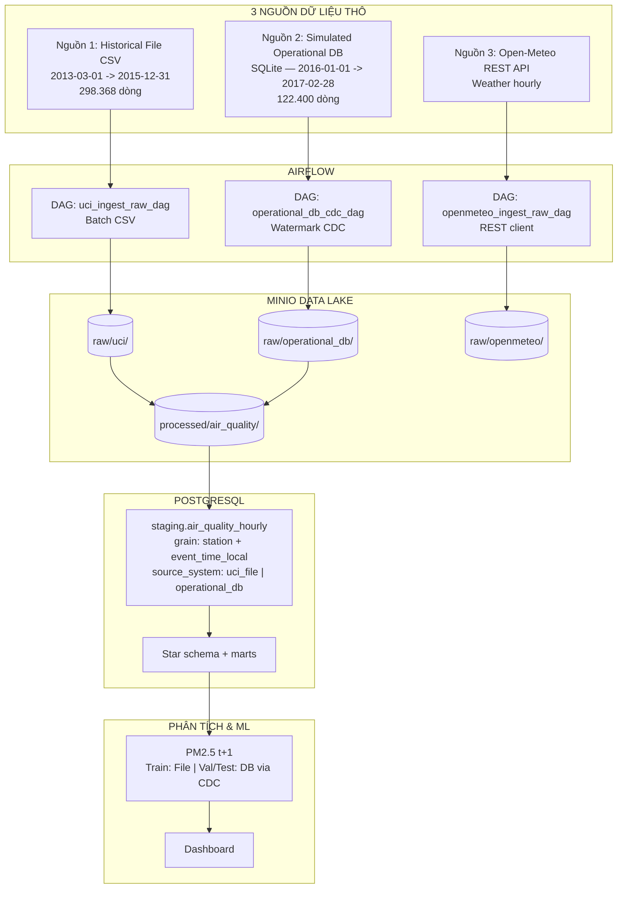

# OPERATIONAL_DB_INGESTION_DESIGN.md — Nguồn Database mô phỏng & Watermark CDC

> **Dự án:** Air Quality Analytics Platform (Bắc Kinh — PRSA Dataset)  
> **Môn học:** INT1422 — Kho dữ liệu và Khai phá dữ liệu  
> **Trạng thái:** Phương án chốt triển khai  
> **Phiên bản:** 2.2  
> **Cập nhật:** 15/10/2026  
> **Ghi chú v2.2:** Đối soát giờ thực tế UCI → File **298.368** / DB **122.400** (v2.1 lệch 1 ngày).  

---

## 0. Phạm vi & Giới hạn (đọc trước khi triển khai)

Tài liệu này bổ sung **hai cải tiến kiến trúc** theo góp ý giảng viên:

1. **Thêm nguồn Database** (RDBMS) bên cạnh File CSV và REST API.  
2. **Thêm CDC kiểu watermark** trên luồng ingest từ nguồn DB.

### Cách hiểu đúng (bắt buộc khi báo cáo)

| Được nói | Không được nói |
|---|---|
| Nguồn DB là **mô phỏng operational extract** (OLTP-like) từ UCI PRSA | CSDL BMEMC / CNEMC thật đang chạy |
| CDC **replay incremental** theo `event_time` để demo ingest + serving | Hệ thống realtime phát sinh số đo năm 2016–2017 |
| Cùng ground-truth UCI, **tách kênh truy xuất** (File vs DB) cho kịch bản train/serve | Hai nguồn độc lập, khác mạng quan trắc |

UCI PRSA là gói nghiên cứu đóng (2013–02/2017). Không có RDBMS công khai của mạng quan trắc Bắc Kinh để sinh viên kết nối. Vì vậy nhóm **tự dựng SQLite/Postgres nguồn**, nạp phần dữ liệu “giai đoạn vận hành”, rồi Airflow đọc bằng SQL + watermark — đúng kiểu BTL khi không có OLTP thật.

Open-Meteo **giữ nguyên** vai trò API thời tiết (enrichment + fill weather thiếu). Không thêm quotsoft hay nguồn ô nhiễm thứ ba.

---

## 1. Mục tiêu & Quyết định kiến trúc

Mở rộng từ 2 nguồn (File + API) thành **File + Database + API**:

1. **Nguồn 1 — Historical File (CSV)**  
   `2013-03-01 00:00` → `2015-12-31 23:00` — **298.368** dòng (12 trạm × 24.864 giờ).  
   Vai trò: kho lịch sử batch; **Train set** ($\le$ 2015).

2. **Nguồn 2 — Simulated Operational DB (SQLite RDBMS)**  
   `2016-01-01 00:00` → `2017-02-28 23:00` — **122.400** dòng (12 trạm × 10.200 giờ).  
   Vai trò: bảng quan hệ mô phỏng CSDL tác nghiệp; cấp Validation (2016 H1), Test (2016 H2) và demo serving qua **Watermark CDC**.

3. **Nguồn 3 — External Weather API (Open-Meteo)**  
   REST/JSON khí tượng bổ sung theo giờ (như hiện tại).

**Tổng ground truth:** $12 \times 35.064 = 420.768$ dòng.  
**Đối soát:** `|File| + |DB| = 298.368 + 122.400 = 420.768`.

Phân mốc thời gian **khớp** split ML đã chốt (Train ≤2015 | Val 2016 H1 | Test 2016 H2; 2017 = sensitivity).

---

## 2. Sơ đồ luồng dữ liệu



---

## 3. Thiết kế nguồn Database mô phỏng

### 3.1. Phân chia dữ liệu

| Kênh | Đường dẫn | Khoảng thời gian | Số dòng | Vai trò |
|---|---|---|---|---|
| File CSV | `data/raw/uci/` | 2013-03-01 → 2015-12-31 | 298.368 | Archive / Train |
| Operational DB | `data/raw/database/prsa_operational.db` | 2016-01-01 → 2017-02-28 | 122.400 | DB nguồn + CDC → Val / Test / serving demo |

Script dựng DB **không bịa số đo**: chỉ tách subset UCI theo `event_time`, ghi vào bảng quan hệ.

### 3.2. DDL nguồn

Tệp: `data/raw/database/prsa_operational.db`

```sql
CREATE TABLE IF NOT EXISTS operational_air_quality (
    record_id INTEGER PRIMARY KEY AUTOINCREMENT,
    station_name TEXT NOT NULL,
    year INTEGER NOT NULL,
    month INTEGER NOT NULL,
    day INTEGER NOT NULL,
    hour INTEGER NOT NULL,
    event_time_local TEXT NOT NULL, -- YYYY-MM-DD HH:MM:SS
    pm25 REAL,
    pm10 REAL,
    so2 REAL,
    no2 REAL,
    co REAL,
    o3 REAL,
    temp REAL,
    pres REAL,
    dewp REAL,
    rain REAL,
    wd TEXT,
    wspd REAL,
    created_at TEXT DEFAULT CURRENT_TIMESTAMP
);

CREATE INDEX IF NOT EXISTS idx_station_event_time
ON operational_air_quality(station_name, event_time_local);

CREATE INDEX IF NOT EXISTS idx_event_time
ON operational_air_quality(event_time_local);
```

---

## 4. Watermark CDC trên luồng ingest chung

CDC ở đây là **timestamp watermark incremental extract** từ bảng nguồn DB — thuộc **pipeline ingest**, không phải tính năng riêng của “loại dữ liệu enrichment”.

```text
[1] TRAINING (offline)
    File CSV (<= 2015) → Lake → Staging → DWH → Train model

[2] CDC REPLAY (val / test / serving demo)
    prsa_operational.db
         │  WHERE event_time_local > :watermark
         ▼
    Airflow operational_db_cdc_dag
         ▼
    MinIO raw/operational_db/  →  Staging (source_system = 'operational_db')
         │
         ├─► Features tại giờ t  →  predict PM2.5(t+1)
         └─► Khi watermark tới t+1: so sánh actual vs predicted → MAE
```

### Các bước trong Airflow

1. **Đọc watermark** từ staging (hoặc bảng control riêng):

```sql
SELECT COALESCE(MAX(event_time_local), '2015-12-31 23:00:00')
FROM staging.air_quality_hourly
WHERE source_system = 'operational_db';
```

2. **Delta fetch** từ DB nguồn:

```sql
SELECT *
FROM operational_air_quality
WHERE event_time_local > :last_watermark
ORDER BY event_time_local ASC
LIMIT :batch_size;
```

3. **Ghi Lake:** `raw/operational_db/year=YYYY/month=MM/batch_<ts>.json`  
   Sidecar `.meta.json`: `record_count`, `source_sha256`, `watermark_start`, `watermark_end`.

4. **Load staging** với `source_system = 'operational_db'`.  
5. **Serving + đánh giá liên tục** (bắt buộc trong phạm vi cải thiện — xem §5).

Idempotent: cùng watermark + batch không nhân đôi bản ghi (upsert theo `station_name + event_time_local`).

---

## 5. Cải thiện: serving demo + đánh giá liên tục theo CDC

Phần này **nằm trong phạm vi cải thiện chính** (không để “làm sau nếu nhớ”). Mục tiêu: chứng minh DB + CDC không chỉ nạp dữ liệu, mà còn nuôi vòng **dự báo → đối soát** giống monitoring production.

### 5.1. Trong scope / ngoài scope

| Trong scope (phải làm) | Ngoài scope (không làm trừ khi mở rộng rõ) |
|---|---|
| Model **đã train** (≤2015) đóng băng khi serve | Online learning / tự cập nhật trọng số mỗi batch |
| Tại watermark giờ *t*: predict PM2.5(*t+1*), **không** dùng actual *t+1* | Dùng số lệch để backprop / fine-tune realtime |
| Khi CDC nạp actual *t+1*: ghi lỗi, cập nhật MAE dần | Tự retrain khi MAE xấu (chỉ ghi là hướng mở) |
| Lưu prediction + actual + abs_error ra mart/bảng; dashboard hoặc artifact xem được | Claim “model tự cải thiện” |

Số lệch dùng để **giám sát & báo cáo**, không phải để model tự học trong phiên bản này.

### 5.2. Quy trình từng bước (anti-leakage)

```text
Watermark = T_max đã có trong staging (operational_db)

VỚI mỗi station, mỗi giờ t mới vừa nạp (t ≤ T_max):
  1. Lấy feature chỉ từ dữ liệu ≤ t   (PM, weather, lag… đã có)
  2. y_hat = model.predict → PM2.5(t+1)
  3. Ghi prediction_log:
       (station, target_time=t+1, y_hat, predicted_at=t, model_version)

KHI CDC sau đó nạp actual tại target_time = t+1:
  4. Join prediction_log với actual pm25
  5. abs_error = |y_hat - y_true|
  6. Cập nhật metrics cửa sổ (MAE / RMSE chạy dần theo batch)
```

Cấm: lấy `pm25` tại *t+1* (hoặc feature suy từ tương lai) vào bước 1–2.

### 5.3. Lưu trữ tối thiểu

Bảng/mart gợi ý (tên cuối có thể map vào `mart.mart_pm25_predictions` nếu đã có):

```text
prediction_log / mart predictions (bổ sung cột CDC nếu cần)
  station_name
  target_time_local          -- giờ đang dự báo (t+1)
  y_hat_pm25
  y_true_pm25                -- NULL cho tới khi actual CDC tới
  abs_error                  -- NULL cho tới khi có y_true
  predicted_at_local         -- giờ t khi predict
  source_system              -- 'operational_db'
  model_version
  eval_batch_id              -- id batch CDC đối soát
```

Artifact chạy demo (tuỳ chọn): `artifacts/cdc_eval/mae_by_batch.json` — MAE tích lũy theo từng batch watermark.

### 5.4. Demo bảo vệ nên thấy gì

1. Watermark tiến (ví dụ từng ngày hoặc từng N giờ).  
2. Có dòng predict trước khi có actual cùng `target_time`.  
3. Sau batch kế: `y_true` + `abs_error` được điền; MAE cập nhật.  
4. Một câu giải thích: *đánh giá liên tục = monitoring; cải thiện model = retrain riêng (ngoài scope).*

---

## 6. Tương thích DWH & ML

1. **Grain:** File và DB cùng `station_name + event_time_local` — không đổi star schema.  
2. **Split ML** (đã chốt):
   - Train ≤2015 → **File**
   - Val 2016 H1 → **DB qua CDC** (có thể dùng để chấm / chọn ngưỡng; không bắt buộc online tune)
   - Test 2016 H2 (2017 sensitivity) → **DB qua CDC** + đánh giá liên tục §5
3. **Open-Meteo:** không đổi Gate B (enrichment `cloud_cover` + fill weather UCI thiếu).  
4. **Lineage:** `source_system` phân biệt File vs DB trên staging.

---

## 7. Kế hoạch triển khai

### Giai đoạn 1 — Dựng DB nguồn
- [x] **1.1** `scripts/setup_operational_db.py`: cắt UCI → giữ CSV ≤2015-12-31; nạp 2016-01-01→2017-02-28 vào `prsa_operational.db`.
- [x] **1.2** Đối soát `|File| + |DB| = 298.368 + 122.400 = 420.768`.

### Giai đoạn 2 — Module ingest DB
- [ ] **2.1** `src/ingestion/db_client.py` — kết nối SQLite, query theo watermark.
- [ ] **2.2** `src/ingestion/db_to_minio.py` — delta batch → `raw/operational_db/`.

### Giai đoạn 3 — Airflow CDC DAG
- [ ] **3.1** `airflow/dags/operational_db_cdc_dag.py`: check → delta → MinIO → load staging.
- [ ] **3.2** Mount `./data/raw/database` vào compose Airflow.

### Giai đoạn 4 — Serving + đánh giá liên tục (phần cải thiện)
- [ ] **4.1** Task/script sau mỗi batch CDC: predict *t+1* từ feature ≤ *t*, ghi `prediction_log` (`y_true` = NULL).
- [ ] **4.2** Khi actual *t+1* có mặt: backfill `y_true`, `abs_error`; cập nhật MAE theo batch.
- [ ] **4.3** Kiểm anti-leakage: tại thời điểm predict, không đọc PM2.5(*t+1*).
- [ ] **4.4** Xuất artifact hoặc mart để dashboard/báo cáo xem lệch dần.

### Giai đoạn 5 — Kiểm chứng end-to-end
- [ ] **5.1** Chạy DAG; kiểm MinIO + staging `source_system = 'operational_db'`.
- [ ] **5.2** Reconcile đủ 420.768 trên staging (File + CDC).
- [ ] **5.3** `dbt build` + demo watermark tiến → predict → đối soát → MAE cập nhật.

### Ngoài scope (ghi rõ, không làm lẫn vào §5)
- Online learning / partial_fit mỗi giờ.  
- Tự retrain khi MAE vượt ngưỡng (có thể đề xuất slide “hướng phát triển”).

---

## 8. Giải trình khi bảo vệ

* **Ba nguồn:** File (archive lịch sử), Database mô phỏng (operational extract quan hệ), API Open-Meteo (thời tiết). Ba *cách lấy* khác nhau; pollutant ground-truth vẫn từ UCI.  
* **Vì sao DB mô phỏng:** không có OLTP quan trắc Bắc Kinh public; BTL chấp nhận tự host RDBMS + connector SQL.  
* **CDC:** watermark theo `event_time` — chỉ nạp phần mới; kết hợp **serving + đánh giá liên tục** (predict rồi đối soát khi actual tới).  
* **Số lệch dùng để làm gì:** giám sát chất lượng dự báo theo thời gian (MAE dần), **không** tự sửa trọng số model trong phiên bản này.  
* **Hạn chế:** *replay* lịch sử đã biết, không phải stream realtime từ trạm; giá trị nằm ở đa nguồn + incremental ingest + monitoring gần production.
